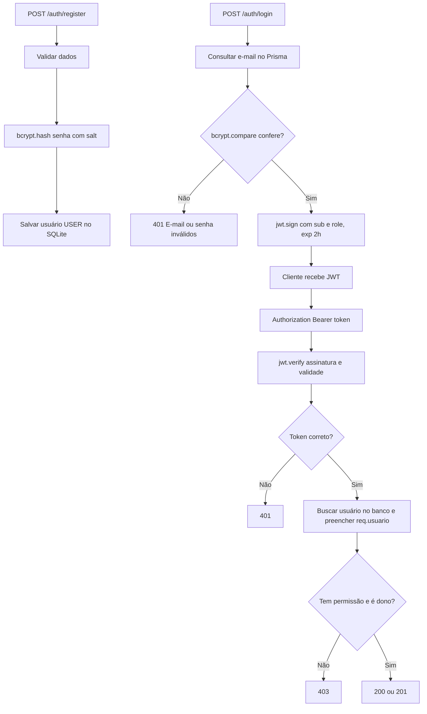

# API Academia — Projeto API Segura

**ETEC de Campo Limpo Paulista (ETECAMP) | 3º AI | 4º bimestre**  
**Integrantes:** [Murilo Henrique Almeida de Santana] · [Pedro Gabriel Farias da Silva] · [Gustavo Henrique de Souza Faria]  
**Tema escolhido:** Academia.  
**Tecnologias:** Node.js, Express 5, Prisma ORM 7, SQLite, JWT (`jsonwebtoken`), `bcryptjs`.

## 1. Sobre o projeto

A API permite que alunos registrem e acompanhem treinos de academia. Cada treino tem título, objetivo, exercícios, marcação de conclusão e um dono. Um aluno (`USER`) só pode consultar e modificar seus próprios treinos; um instrutor (`ADMIN`) pode consultar e administrar qualquer treino e gerenciar perfis de usuários. O dono é definido no servidor a partir do token, nunca por um campo controlado pelo cliente.

**Recurso principal:** `Treino` (relação 1:N: um `User` possui vários `Treino`).

## 2. Como rodar, do zero

**Requisitos:** Node.js 20.19+ (preferencialmente 22 ou mais recente) e npm. Execute no terminal, dentro da pasta do projeto.

```bash
npm install
```

Copie o arquivo de exemplo para `.env`:

```powershell
# Windows (Prompt de Comando ou PowerShell)
copy .env.example .env
```

```bash
# Linux / macOS
cp .env.example .env
```

**Abra o `.env` e substitua `JWT_SECRET` por uma chave aleatória com pelo menos 32 caracteres.** Por exemplo, gere uma no terminal com:

```bash
node -e "console.log(require('crypto').randomBytes(32).toString('hex'))"
```

Depois execute **na ordem**:

```bash
npx prisma migrate dev
npx prisma generate
npx prisma db seed
npm run dev
```

A API ficará em `http://localhost:3000` e o front-end em `http://localhost:3000/painel`.

**Usuários de demonstração após o seed** (todos usam a senha **`Treino@123`**, apenas para ambiente local):

| E-mail | Perfil | Quem é |
|---|---|---|
| `admin@academia.test` | ADMIN | Instrutora Ana |
| `joao@academia.test` | USER | João |
| `maria@academia.test` | USER | Maria |

O seed adiciona um treino de João e outro de Maria. Use apenas essas contas de demonstração para testes. O seed é repetível, mas restaura as senhas de teste e recria os treinos dos dois alunos; não use em dados reais.

Para recomeçar o banco local do zero:

```bash
npx prisma migrate reset --force
npx prisma generate
npx prisma db seed
```

> Prisma 7 exige um driver adapter, configurado em `src/lib/prisma.ts`. O endereço do SQLite vem de `DATABASE_URL` no `.env`. O Prisma Client é gerado em `generated/prisma/`, pasta ignorada pelo Git.

## 3. Mapa de rotas

| Método | Rota | Acesso | Como é protegida |
|---|---|---|---|
| GET | `/` | Público | Status da API |
| GET | `/painel` | Público | Interface demonstrativa |
| POST | `/auth/register` | Público | Validação, bcrypt, perfil forçado a USER |
| POST | `/auth/login` | Público | Comparação de senha, JWT, limite de tentativas |
| GET | `/auth/me` | Logado | `autenticar` |
| PATCH | `/auth/senha` | Logado | `autenticar` + senha atual (extra) |
| GET | `/treinos` | Logado | `autenticar` + filtro do dono para USER |
| POST | `/treinos` | Logado | `autenticar` + dono atribuído pelo token |
| GET | `/treinos/:id` | Dono / ADMIN | `autenticar` + regra do dono |
| PUT | `/treinos/:id` | Dono / ADMIN | `autenticar` + regra do dono |
| DELETE | `/treinos/:id` | Dono / ADMIN | `autenticar` + regra do dono |
| GET | `/users` | ADMIN | `autenticar`, depois `autorizar("ADMIN")` |
| PATCH | `/users/:id/role` | ADMIN | `autenticar`, depois `autorizar("ADMIN")` |

Respostas principais: `200` sucesso, `201` criado, `400` dados inválidos, `401` sem autenticação válida, `403` sem permissão, `404` não encontrado, `409` e-mail duplicado e `429` excesso de tentativas de login.

## 4. Matriz de permissões

| Ação | Visitante | USER | ADMIN |
|---|---|---|---|
| Cadastrar conta | 201 | 201 | 201 |
| Fazer login | 200 ou 401 | 200 ou 401 | 200 ou 401 |
| Consultar `/auth/me` | 401 | 200 | 200 |
| Listar treinos | 401 | 200, só os seus | 200, todos |
| Criar treino | 401 | 201, dono = token | 201, dono = token |
| Ver/alterar/excluir treino próprio | 401 | 200 | 200 |
| Alterar/excluir treino de outro usuário | 401 | 403 | 200 |
| Alterar/excluir treino inexistente | 401 | 404 | 404 |
| Listar usuários | 401 | 403 | 200 |
| Alterar perfil | 401 | 403 | 200 (válido) |
| Trocar a própria senha | 401 | 200 (senha atual correta) | 200 (senha atual correta) |

A matriz mostra respostas de referência para dados válidos; pedidos inválidos podem devolver `400` e tentativas de login excessivas podem devolver `429`.

## 5. Como funciona a autenticação



### Cadastro (`src/controllers/auth.controller.ts`)

O controlador confere nome, e-mail e senha (mínimo de 6 caracteres), rejeita duplicidade e usa `bcrypt.hash(senha, 12)` para gerar um hash com salt. No cadastro, `role` **não é recebido do corpo**: o Prisma aplica `USER` por padrão. O `select: usuarioSeguro` impede que a coluna `password` seja enviada ao cliente.

### Login (`src/controllers/auth.controller.ts`)

Busca o e-mail, compara a senha informada com o hash por `bcrypt.compare()` e usa o mesmo erro genérico tanto para usuário inexistente quanto para senha errada. Em caso de sucesso, `jwt.sign()` cria um token com `sub` (id do usuário), `role`, `iat` e `exp`, assinado com HS256 e com validade configurável de 2 horas.

### Middleware `autenticar` (`src/middlewares/autenticar.ts`)

1. Lê `Authorization` e exige `Bearer <token>`.
2. Chama `jwt.verify()` dentro de `try/catch`, restringindo o algoritmo a HS256; assinatura, expiração ou formato inválidos retornam `401`.
3. Lê `sub`, busca o usuário atual no banco sem trazer a senha e preenche `req.usuario`.
4. Só então entrega a requisição ao próximo middleware, com `next()`.

**Importante:** a API verifica o perfil atual no banco, não confia no `role` eventualmente desatualizado do payload. Assim, uma alteração de perfil produz efeito na próxima requisição; o JWT antigo ainda existe até expirar.

## 6. Como funciona a autorização

### RBAC (`src/middlewares/autorizar.ts`)

O middleware `autorizar(...perfis)` verifica `req.usuario.role` e responde `403` se o perfil não estiver na lista. Ele é usado em `/users` depois de `autenticar`. Exemplo: um `USER` em `GET /users` recebe `403`, enquanto um `ADMIN` recebe `200`.

### Regra do dono (`src/controllers/treinos.controller.ts`)

Na criação, `ownerId: req.usuario!.id` associa o novo treino ao usuário autenticado. Um eventual `ownerId` no JSON de entrada é ignorado. Para ler, alterar ou excluir um treino pelo id, a função `verificarAcesso()` primeiro busca o recurso: se não existe, devolve `404`; se existe, mas não é do solicitante e ele não é ADMIN, devolve `403`.

Na listagem, a consulta de `USER` inclui o filtro `where: { ownerId: req.usuario.id }`; a de ADMIN não tem essa limitação. A senha não está presente no retorno dos usuários nem nos relacionamentos dos treinos.

## 7. Decisões do grupo e cuidados de segurança

- **Payload:** `sub` identifica o usuário, `role` facilita explicar permissões na apresentação, `iat` e `exp` indicam emissão e expiração. Senha, hash, CPF e outros dados privados não entram no JWT.
- **Validade:** `JWT_EXPIRES_IN=2h`, para equilibrar um tempo razoável de demonstração e a duração limitada do token.
- **Segredo:** `JWT_SECRET` somente no `.env` local. O `.gitignore` ignora `.env`, arquivos `.db`, `node_modules` e `generated/`. O repositório inclui apenas `.env.example`.
- **Perfis:** apenas ADMIN pode promover ou rebaixar outros usuários. Não é permitido auto-rebaixamento do próprio ADMIN para evitar bloqueio acidental.
- **Logout:** na interface demonstrativa, o logout apaga o token guardado **em memória**. Não há revogação do token no servidor: até expirar, um token já copiado ainda seria aceito. Em produção seria necessário blacklist/versão do token ou sessões/refresh tokens revogáveis.
- **Produção:** usar HTTPS, validação mais forte de senhas, proteção anti-XSS, persistência e limite por conta para o rate limit, logs/auditoria, revogação no reset de senha e refresh token rotativo.
- **Limitações:** é um trabalho didático, não um sistema pronto para armazenar dados reais ou publicar exposto na internet sem melhorias.

## 8. Testes (T1 a T10)

### Testes manuais

Abra `requests.http` na extensão **REST Client** do VS Code ou replique no Thunder Client. Faça login como João, Maria e ADMIN e copie o JWT de cada um para as variáveis no topo do arquivo. O ID do treino da Maria aparece na listagem de treinos do ADMIN.

### Testes automatizados

Em outro terminal, com a API rodando e o banco populado pelo seed:

```bash
npm run test:api
```

O script `scripts/verificar-api.mjs` faz requisições HTTP reais, valida os códigos e inclui testes complementares (bearer incorreto, dono ignorado, perfil, senha ausente nas respostas, limite 429). **Execute sobre um banco de testes/demonstração**, pois ele cria usuários e treinos, promove um usuário de teste e exclui o treino criado. O rate limit é por endereço IP: ao repetir o script em menos de 15 minutos, os logins podem receber `429` antes do esperado. Reinicie a API ou aguarde a janela para repetir.

| Teste | Situação | Código esperado |
|---|---|---|
| T1 | Cadastro válido, resposta sem senha | 201 |
| T2 | Cadastro com e-mail duplicado | 409 |
| T3 | Login com senha errada | 401 |
| T4 | Rota protegida sem token | 401 |
| T5 | Rota protegida com token válido | 200 |
| T6 | Criar treino com `ownerId` falso no body | 201, dono real = token |
| T7 | João tenta alterar treino da Maria | 403 |
| T8 | USER tenta consultar `/users` | 403 |
| T9 | ADMIN consulta `/users` | 200 |
| T10 | Treino inexistente | 404 |

Também há proteção contra header `Bearer` malformado e JWT inválido, e o exercício extra `429` após excesso de logins.

## 9. Fontes e ferramentas utilizadas

- [RFC 7519 — JSON Web Token (IETF)](https://www.rfc-editor.org/rfc/rfc7519)
- [jwt.io — Introdução a JWT](https://jwt.io/introduction)
- [OWASP — Password Storage Cheat Sheet](https://cheatsheetseries.owasp.org/cheatsheets/Password_Storage_Cheat_Sheet.html)
- [OWASP — Authentication Cheat Sheet](https://cheatsheetseries.owasp.org/cheatsheets/Authentication_Cheat_Sheet.html)
- [MDN — Status HTTP](https://developer.mozilla.org/pt-BR/docs/Web/HTTP/Reference/Status)
- [Documentação do Prisma 7 — SQLite](https://www.prisma.io/docs/orm/v7/core-concepts/supported-databases/sqlite)
- [Documentação do Prisma 7 — Seeding](https://www.prisma.io/docs/orm/v7/prisma-migrate/workflows/seeding)
- [Express — Guia de middlewares](https://expressjs.com/en/guide/using-middleware.html)
- [jsonwebtoken (npm)](https://www.npmjs.com/package/jsonwebtoken)
- [bcryptjs (npm)](https://www.npmjs.com/package/bcryptjs)
- **Ferramenta de IA:** ChatGPT (OpenAI), usado no apoio à elaboração do código, organização dos arquivos, pesquisa e documentação. A responsabilidade de revisar, testar, adaptar e explicar o projeto é dos integrantes.

## 10. Pontos extras tentados

| Desafio | Arquivo / teste | Valor máximo |
|---|---|---:|
| Limite de tentativas de login (429) | `src/routes/auth.routes.ts` + `npm run test:api` | +0,3 |
| Troca de senha com confirmação da senha atual | `PATCH /auth/senha` | +0,2 |
| Front-end simples de login e treinos com `fetch` | `public/index.html`, endereço `/painel` | +0,4 |

São **+0,9 pontos potenciais**, sujeitos à demonstração e à avaliação do professor (teto total de +1,0).

## 11. Estrutura dos arquivos

```text
api-segura-academia/
├── .env.example            # Modelo; chave real NÃO deve ir ao GitHub
├── .gitignore
├── prisma.config.ts        # Configuração Prisma 7 e seed
├── prisma/
│   ├── schema.prisma       # User, Role, Treino, relação 1:N
│   ├── seed.ts             # ADMIN, João, Maria e dois treinos
│   └── migrations/         # SQL de criação das tabelas
├── src/
│   ├── app.ts              # Rotas, interface, erros
│   ├── server.ts           # Porta e inicialização
│   ├── controllers/        # Login, usuários e treinos
│   ├── middlewares/        # autenticar, autorizar
│   ├── routes/             # Organização das rotas
│   ├── utils/              # Validação e select seguro
│   └── lib/prisma.ts       # Prisma Client + driver adapter
├── public/index.html      # Front-end extra
├── requests.http          # T1–T10 manuais
├── scripts/               # Teste automatizado e exemplo JWT
├── PESQUISA.md            # 12 respostas e referências
├── ROTEIRO_APRESENTACAO.md
└── COMO_ENTREGAR.md
```
